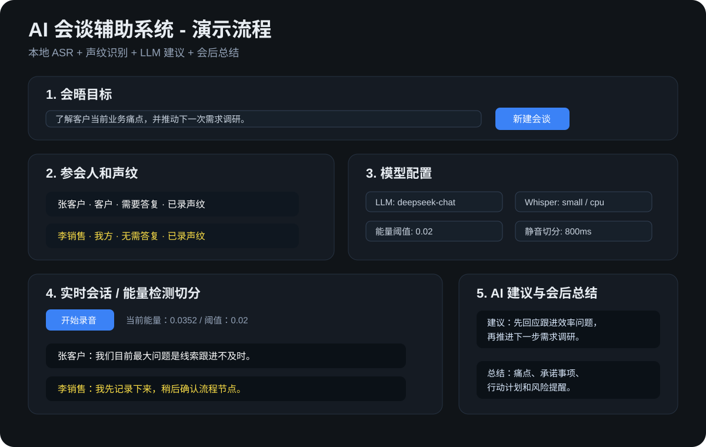

# AI 会谈辅助系统

本项目是一个本地单机运行的 AI 会谈辅助系统原型。系统在客户笔记本电脑本地运行 `client` 和 `server`，通过浏览器录音，后端使用本地 `faster-whisper` 完成语音转文字，使用 `SpeechBrain` 进行声纹识别，并通过 OpenAI Compatible 大模型 API 生成会谈建议回复和会后总结。



## 1. 核心能力

- 本地 Web 前端页面；
- 本地 FastAPI 后端服务；
- 输入会晤目标；
- 维护参会人列表；
- 录入参会人声纹样本；
- 基于浏览器 WebAudio RMS 能量检测进行语音切分；
- 本地 faster-whisper 转写；
- 本地 SpeechBrain 声纹匹配；
- 手动修正消息说话人；
- 页面维护 LLM / Whisper / 声纹阈值 / 能量阈值配置；
- 独立 ASR Provider 配置：FunASR streaming / faster-whisper / OCI Speech；
- 根据参会人配置判断是否生成 AI 建议回复；
- 客户发言白色展示，我方发言黄色展示；
- 一键生成结构化会后总结；
- 会议 Agent 工作台：维护上下文、客户痛点、风险、承诺、待办、问题和决策日志；
- 会话记录和导出 Markdown 保存在本地文件中。

## 2. 技术栈

```text
前端：React + Vite + TypeScript
后端：Python + FastAPI
语音识别：faster-whisper
声纹识别：SpeechBrain
音频处理：ffmpeg
大模型：OpenAI Compatible API
部署：Docker Compose
CI：GitHub Actions
```

## 3. 快速启动

### 3.1 准备配置

项目可在没有 `.env` 的情况下启动，页面“模型配置”中也可以维护运行时配置。推荐先复制示例配置：

```bash
cp .env.example .env
```

编辑 `.env`，填入你的大模型 API Key：

```env
LLM_PROVIDER=deepseek
LLM_MODEL=deepseek-chat
LLM_BASE_URL=https://api.deepseek.com
LLM_API_KEY=你的API_KEY
```

### 3.2 Docker Compose 启动

```bash
docker compose up -d --build
```

默认使用开发模式（`server/Dockerfile.dev`、`client/Dockerfile.dev`）：容器只提供运行依赖环境，源码通过 bind mount 从本机实时映射，**修改 `server/app` 或 `client/src` 下的代码无需重建镜像**（后端自动重启、前端 HMR 热更新）。

启动后访问：

```text
http://localhost:3000
```

后端接口地址：

```text
http://localhost:8000
```

API 文档：[`docs/API.md`](docs/API.md)

Agent 定义：[`AGENTS.md`](AGENTS.md)

健康检查：

```bash
curl http://localhost:8000/api/health
```

## 4. 本地开发与验证

### 4.1 开发模式说明

默认 `docker compose up -d --build` 即为开发模式，容器与本机源码映射关系如下：

| 容器 | 依赖环境（镜像内，依赖变化时才重建） | 本机源码挂载（改代码无需重建） |
| --- | --- | --- |
| server | Python 包、ffmpeg（`server/Dockerfile.dev`） | `./server/app` → `/app/app`，配 `uvicorn --reload` 自动重启 |
| client | node_modules（`client/Dockerfile.dev`） | `./client/src`、`index.html`、`vite.config.ts`、`tsconfig.json` → `/app`，Vite HMR 热更新 |

因此日常开发只需直接编辑本机源码：

- 改 `server/app/**/*.py`：后端自动重启生效；
- 改 `client/src/**`：前端浏览器自动热更新。

只有当依赖发生变化时才需要重建镜像：

- 新增 Python/pip 包（改动 `server/requirements*.txt`）：

  ```bash
  docker compose up -d --build
  ```

- 变更 `client/package-lock.json`（`npm install` 增删依赖）：client 的 `/app/node_modules` 由**匿名卷**保护，普通 `--build` 会重建镜像但**沿用旧匿名卷**，导致新依赖没生效。需强制重建匿名卷：

  ```bash
  docker compose up -d --build --renew-anon-volumes
  ```

  或先清理容器再重建：

  ```bash
  docker compose down
  docker compose up -d --build
  ```

  > 注意：`docker compose down`（不带 `-v`）不会删除匿名卷本身；`--renew-anon-volumes` 是最稳妥的做法，它会为 client 重新创建挂载了镜像内新 `node_modules` 的匿名卷。本 compose 中只有 client 使用匿名卷，server 的数据与模型缓存都是有名字的 bind mount，不受影响。

> 生产部署：`server/Dockerfile`、`client/Dockerfile`（会把源码 COPY 进镜像）仍然保留。需要构建自包含镜像时，将 `docker-compose.yml` 中两个服务的 `build.dockerfile` 改回 `Dockerfile` 并移除源码 bind mount 即可。
>
> 生产部署注意：客户端是 Vite dev server，`/api` 代理目标由 `VITE_API_PROXY_TARGET` 决定，默认 `http://localhost:8000`。切回生产镜像后如后端不在同一容器，需要显式设置该环境变量（例如 `http://server:8000`），否则前端请求会打到客户端容器自身的 8000 端口。两份生产 Dockerfile 已通过静态检查（基础镜像、`COPY` 来源、`.dockerignore` 均正确），但尚未做完整 `docker build` 验证（需拉取 torch / funasr 等大依赖）。

如果需要脱离 Docker 单独调试前端，也可以在宿主机直接运行 Vite（先确保 3000 端口未被容器占用）：

```bash
docker compose stop client
cd client && npm install && npm run dev:host
```

前端会通过 Vite 代理把 `/api` 请求转发到后端 `http://localhost:8000`。

如果通过 SSH 访问远程开发机，只需要转发前端端口：

```bash
ssh -N -L 8099:localhost:3000 用户名@远程服务器地址
```

然后在本地浏览器访问：

```text
http://localhost:8099
```

### 4.2 构建与检查

前端构建：

```bash
cd client
npm install
npm run build
```

后端语法检查：

```bash
cd server
python -m compileall app
```

Docker 构建：

```bash
docker compose build
```

> 后端依赖使用 PyTorch CPU wheel，避免默认拉取大型 CUDA 运行时包。

## 5. 本地数据目录

运行后会在项目根目录生成 `data/`：

```text
data/
├── model_config.json
├── participants.json
├── participants/
├── sessions/
│   └── {meeting_id}.memory.json
├── audio/
└── exports/
```

FunASR / ModelScope 模型缓存会保存在：

```text
model_cache/
hf_cache/
```

这些目录用于避免容器重建后重复下载 ASR 模型，已加入 `.gitignore`。

## 6. 演示流程

1. 打开 `http://localhost:3000`；
2. 在“模型配置”中检查 LLM、Whisper、声纹阈值、能量切分阈值；
3. 添加参会人，并设置角色：我方 / 客户 / 其他；
4. 为参会人录入 10 秒左右声纹样本；
5. 输入会晤目标并点击“新建会谈”；
6. 点击“开始录音”；
7. 前端按能量阈值和静音时长自动切分语音片段并上传；
8. 后端完成转写和声纹识别；
9. 如识别错误，在消息右侧下拉框手动修正说话人；
10. 对需要答复的参会人发言生成 AI 建议回复；
11. 会后点击“生成会后总结”；
12. 点击“导出会话”保存 Markdown 文件。

## 7. 许可证

本项目使用 [MIT License](LICENSE)。
